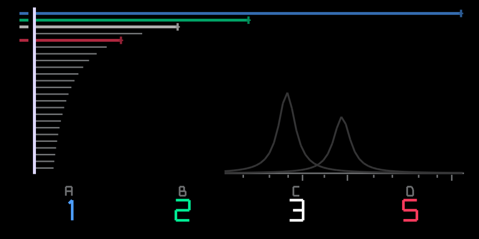
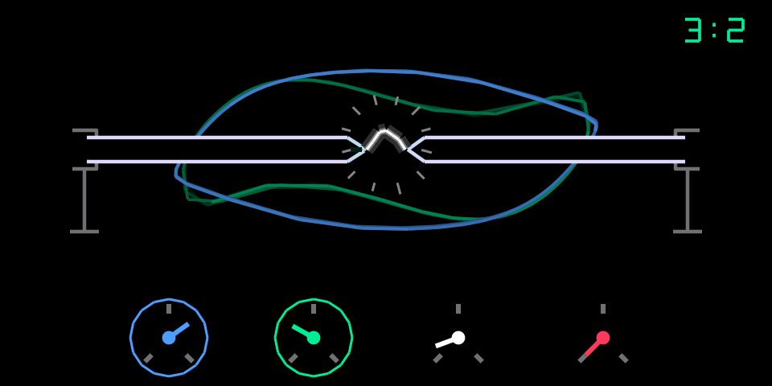
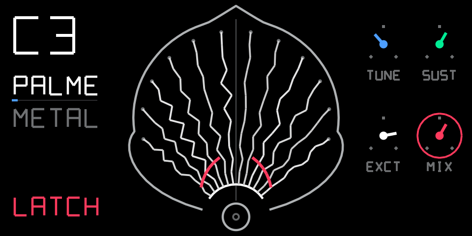
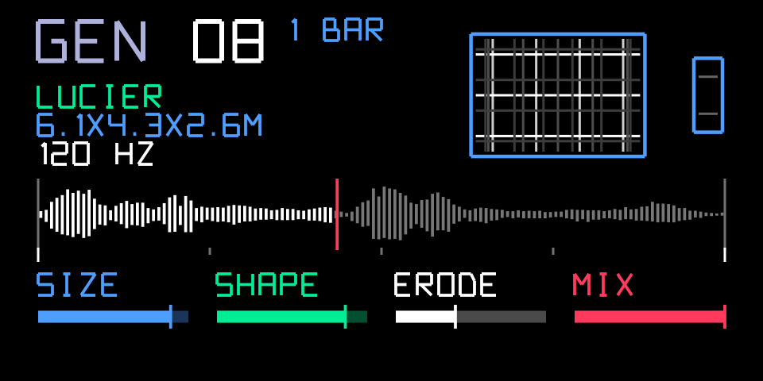
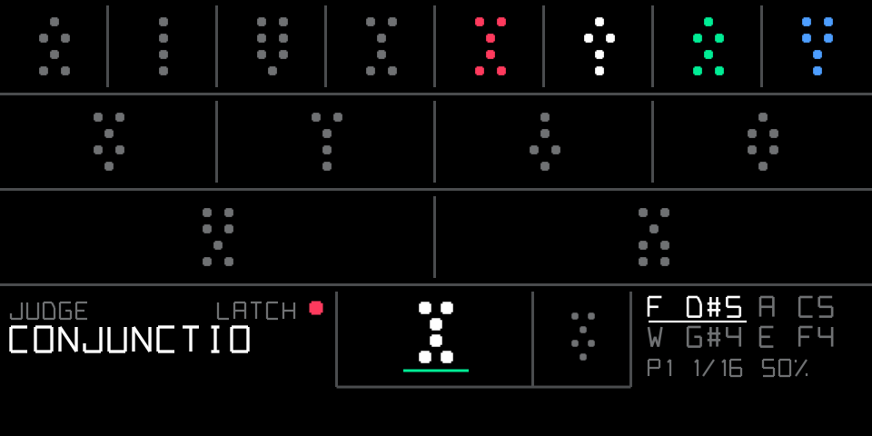
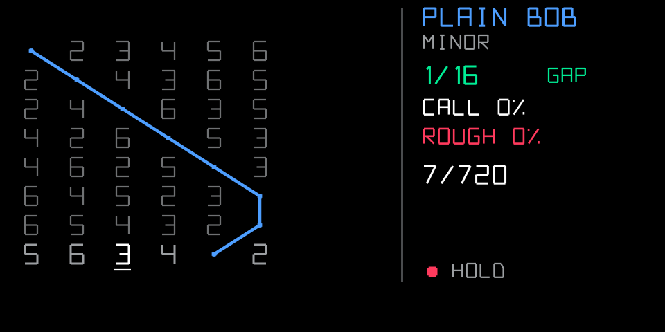

# Musica Obscura for the OP-1 (original)

Six new modules for the original OP-1: two synths, two effects and two sequencers. Each one is built on an obscure
or half-forgotten idea from the history of music and sound. These include a subharmonic organ, a singing street
lamp, the Ondes Martenot's string loudspeaker and Alvin Lucier's room. The sequencers are a geomancy oracle and
English church bells.

They run inside [op1r](https://github.com/pcppcp/op1r) (firmware R246) and are written against the op1r plugin
SDK in [op1r-src](https://github.com/pcppcp/op1r-src). The code is submitted to op1r; this repository holds the
stories, the screens and the sounds.

| | module | idea | type |
|---|---|---|---|
|  | [**mixtur**](#mixtur--the-undertone-organ) | Oskar Sala's Mixtur-Trautonium, 1950s | synth |
|  | [**arc**](#arc--the-singing-street-lamp) | William Duddell's singing arc, 1899 | synth |
|  | [**palme**](#palme--the-string-loudspeaker) | Ondes Martenot "Palme" diffuseur, 1950 | effect |
|  | [**in a room**](#in-a-room--i-am-sitting-in-a-room) | Alvin Lucier, *I am sitting in a room*, 1969 | effect |
|  | [**oracle**](#oracle--the-geomancers-drum-machine) | geomancy, the Shield chart | sequencer |
|  | [**peal**](#peal--english-change-ringing) | English change ringing, 1600s | sequencer |

> **Status:** all six are tested on a real OP-1 with op1r 30 and submitted to op1r as a pull request
> (link below). Until a release includes them, you can build them from the PR branch.

---

## mixtur — the undertone organ

In the 19th century, music theorists argued about a ghost: the *undertone series*, the mirror image of the
overtones. Instead of f, 2f, 3f …, it runs f, f/2, f/3 … downward. Hugo Riemann built a theory of the minor chord
on it, but nothing in nature produces it. In the 1950s Oskar Sala made it real. His Mixtur-Trautonium used
frequency dividers locked to its oscillators to sound the undertones of every note, coloured by resonant formant
circuits. That dark, vocal, slightly unearthly sound is the bird attacks in Hitchcock's *The Birds* (1963), which
has no conventional film score.

In `mixtur` the key you play is the **top** note. Four sawtooth dividers sound its undertones f/n beneath it. They
all come from one master phase, so they never drift, and two band-pass formants shape the result into vowels. The
overtone series gives a major chord; the undertone series gives a minor one. Undertones that would fall below the
audible range (a 13 Hz "tone" is really 13 clicks a second) fade out on the lowest keys.

| knob | turn | page 2 (press) |
|---|---|---|
| blue | undertone A: off, 1 … 24 | formant 1 (180 Hz – 4 kHz) |
| green | undertone B | formant 2 (500 Hz – 5.7 kHz) |
| white | undertone C | resonance |
| orange | undertone D | — |

The screen is the **undertone ladder**: 24 strings, string *n* is 1/*n* long, and their ends trace the hyperbola
of the series. While you play, beads step down the active strings at the dividers' (slowed) pace.

🔊 [mixtur.mp3](sounds/mixtur.mp3): the default 1·2·3·5 mixture, then 1·3·7·9 · all screen states: [1](screens/mixtur_states.png),
[page 2](screens/mixtur_page2_states.png)

---

## arc — the singing street lamp

In 1890s London the carbon arc street lamps hissed and howled, and William Duddell was asked to find out why. The
arc has *negative resistance*. When he put a capacitor and an inductor across it, the lamp became an oscillator.
He switched the capacitors from a keyboard and played tunes on a street light. It was one of the very first
electronic instruments, and it was loud enough to hear without a telephone receiver.

Each `arc` voice is a Van der Pol oscillator, the textbook model of exactly this kind of circuit. Turn up the
current and it goes from a pure sine, through a reedy buzz, to a screaming relaxation sawtooth, and it stays in
tune the whole way. Noise in the plasma makes the pitch wander, and an ignition strike makes it sag and spit. On
page 2 a second lamp joins in. It locks to the first, beats against it, or goes chaotic.

| knob | turn | page 2 (press) |
|---|---|---|
| blue | current: sine → buzz → scream | 2nd lamp ratio (1/2 … 2, detents at simple ratios) |
| green | carbon: asymmetry, even harmonics | coupling: off → locking → chaos |
| white | hiss: plasma noise | brightness |
| orange | strike + sputter: an ignition swoop on each note, and a failing-lamp flicker while notes are held | — |

Behind the two carbon rods the screen draws the oscillator's live **phase portrait**. It starts as a circle and
bends into the squared-off relaxation loop as the current rises. The second lamp is drawn in green.

🔊 [arc.mp3](sounds/arc.mp3): low current (sine), mid, then high current with strike + sputter ·
[all screen states](screens/arc_states.png)

---

## palme — the string loudspeaker

The Ondes Martenot (1928), loved by Messiaen and Jonny Greenwood, never played through an ordinary speaker. It
had *diffuseurs*. The **Palme** is a lyre-shaped cabinet strung with twelve strings, one for each semitone,
which ring in sympathy with whatever the instrument plays. The **Métallique** replaced the speaker cone with a
gong.

`palme` puts the Palme on any OP-1 track or on the master. Twelve tuned strings are excited by the input; each
note you play sets its own string ringing. Dial in *métallique* and the strings glide to the inharmonic modes of
a gong, with detuned twins that beat against each other. A press of orange lifts the damper (*étouffoir*). Whatever
the strings caught keeps ringing as a drone, with the harmonics fading and the fundamentals held, until you
press it again.

| knob | turn | page 2 (press) |
|---|---|---|
| blue | tuning: root note C2 – B4 (the strings are the 12 semitones above it) | métallique: palme → gong |
| green | sustain (0.25 – 30 s) | damping: dark felt → bright wire |
| white | excite: how hard the input strikes the strings | spread: detune up to ±35 cents |
| orange | mix | **press: étouffoir off (drone)** |

The screen is the palm-leaf soundboard. Each of the 12 strings is drawn from its own delay line, so it shows the
waveform that string is actually ringing. The gong's rings fade in with métallique, and the felt damper swings
open like two red wings when you lift it.

🔊 [palme.mp3](sounds/palme.mp3): plucks, a latched drone, then métallique ·
[all screen states](screens/palme_states.png)

---

## in a room — I am sitting in a room

In 1969 Alvin Lucier recorded himself reading a short text, played the tape back into the room and recorded it
again. He repeated this generation after generation. Each pass reinforced the room's own resonances and wore
away everything else, until the words were gone and only the room's chord was left.

`in a room` does this on a loop. Press orange to record a phrase (generation 0). From then on every pass of the
loop plays it through a model of a real room and writes it back. The room's resonances are calculated from its
**actual dimensions** (axial modes, f = n·c/2L). The counter shows how many times your phrase has been through
the room. Speech melts into a chord within about ten generations.

The loop can also be **locked to the tempo**: choose a musical length (1/16 up to 2 bars) and pressing orange
*arms* the recording, which starts on the next beat or downbeat and lasts exactly that long. Every generation then
stays on the beat grid of the OP-1's metronome and tape.

| knob | turn | page 2 (press) |
|---|---|---|
| blue | size: room size (0.8 – 8 m) | loop: FREE 0.5 – 3.9 s, or synced 1/16, 1/8, 1/4, 1/2, 1 bar, 2 bars |
| green | shape: CUBE, GOLDEN, BOLT, LUCIER | absorb: high-frequency loss per generation |
| white | erode: how hard each generation is filtered | — |
| orange | mix | **press: record (free) / arm (synced), press again to cancel** |

On the screen: the generation counter with the loop length, the room's floor plan with the nodal lines of the
modes lighting up, the loop's waveform turning from spiky speech into smooth tones, and labelled knob bars.

🔊 [in-a-room.mp3](sounds/in-a-room.mp3), 24 generations of speech in the Lucier room ·
[in-a-room-sync.mp3](sounds/in-a-room-sync.mp3), a tempo-synced 1-bar loop at 120 BPM ·
[all screen states](screens/in-a-room_states.png)

---

## oracle — the geomancer's drum machine

Geomancy, *ʿilm al-raml*, "the science of sand", came from the Arab world into medieval Europe, where Agrippa
and Robert Fludd wrote about it. The geomancer casts four random figures, the **Mothers**. Each figure has four
rows (Fire, Air, Water, Earth) of one or two dots. Everything else is derived from the Mothers by fixed rules.
The **Daughters** are the Mothers read sideways. **Nieces**, **Witnesses**, the **Judge** and the
**Reconciler** come from adding pairs of figures row by row. The Judge gives the answer, and because of the
arithmetic it can only ever be one of 8 of the 16 figures.

A finished Shield chart is exactly 16 figures of 4 rows: a **16-step, 4-lane pattern**, all grown from 16 random
bits. In `oracle` every row is a lane and a single dot is a hit. Like the stock sequencers, it plays while you
hold a key: in synth mode the lanes are a chord voicing above that key, in drum mode each lane is a drum sound.
Turn an encoder to change a Mother and the change ripples down through the whole chart, like a fill that grows
out of the groove. The step on the Judge is accented.

| control | action |
|---|---|
| hold a key | play, transposed to that key (drums: any key); release stops at the next step |
| shift + key | latch: keeps playing after you let go |
| blue / green / white / orange | set the figure of Mother 1 – 4 (16 named figures) |
| press an encoder | re-cast that Mother at random |
| shift + orange press | voicing: open, major, minor, sus4, maj7, min7, dom7, quartal, power, octaves |
| shift + white press | edit: keys set the selected lane's interval (synth) or drum sound |
| shift + blue / green / white | rate / gate / select lane |
| shift + F G A B | pattern 1 – 4 |
| shift + G A B C · shift + D# | mute lane 1 – 4 · mute all |
| shift + C# | start / stop |

The screen is the Shield itself, drawn in dots, with the playhead walking the figures and the Judge's Latin name
shown at the bottom: *Acquisitio*, *Carcer*, *Conjunctio* …

[all screen states](screens/oracle_states.png)

---

## peal — English change ringing

English bell ringers don't play melodies. Since the 1600s (Fabian Stedman's *Campanalogia*, 1677) they have
permuted the order of the bells row by row, following fixed rules called *methods*, never repeating a row until
the bells come back to *rounds*. Ringing every possible order on 8 bells means 40,320 rows. It has been done once
on tower bells, in 1963, in just under 18 hours. Ringers don't read the rows; they memorise the path their bell
traces through them, the *blue line*.

In `peal` you hold 3 to 8 keys and they ring as your bells for as long as you hold them (shift latches). The
highest is the treble, bell 1. Each row rings
the bells in their current order, then the method permutes them. It keeps the real **handstroke gap**, a beat of
rest after every second row, which gives ringing its limp. Call **"Bob!"** and the permutation forks at the next
lead end, as the conductor would call it in the tower.

| control | turn | press |
|---|---|---|
| blue | method: Plain Hunt, Plain Bob, Grandsire, Stedman | handstroke gap on/off |
| green | rate | "That's all": stop at the next rounds |
| white | automatic call chance | call Bob (shift: Single) at the next lead end |
| orange | rough striking (humanise) | back to rounds |
| shift + blue / green / white / orange | octave / gate / level / start-stop | |
| shift + keys · shift + C# | latch · start / stop with the last bells | |

The screen scrolls the rows, with the treble's blue line drawn through them, flashes BOB and SINGLE, counts the
rows against the extent (*n*!) and shows **ROUNDS** when the bells come home.

[all screen states](screens/peal_states.png)

---

## Guide

A one-page PDF with the background and controls of all six: [musica-obscura-guide.pdf](musica-obscura-guide.pdf).

## Install

The modules are submitted to op1r: [pcppcp/op1r-src#1](https://github.com/pcppcp/op1r-src/pull/1). Once a release includes them, use the
[op1r web patcher](https://pcppcp.github.io/op1r/web/). Until then, build the PR branch with op1r-src's
`make_firmware.py` (see its README).

**Before going back to a firmware without these modules,** change any saved sound that uses the palme or in a room
FX to another FX: the OP-1 stops at boot when a saved sound names an FX it doesn't know. (Synth engines are safe:
an unknown one loads as the stock iter engine.)

Flashing custom firmware is at your own risk. The bootloader is never modified, and you can always go back by
flashing the stock `op1_246.op1` (hold COM at boot).

## Credits

Built by ultralazr, on top of op1r and its plugin SDK by popcorp (pcppcp).
Texts, screens and sounds in this repository: [CC BY 4.0](LICENSE). The module code is licensed like op1r
(GPL-3.0-or-later with the OP-1 firmware permission).
